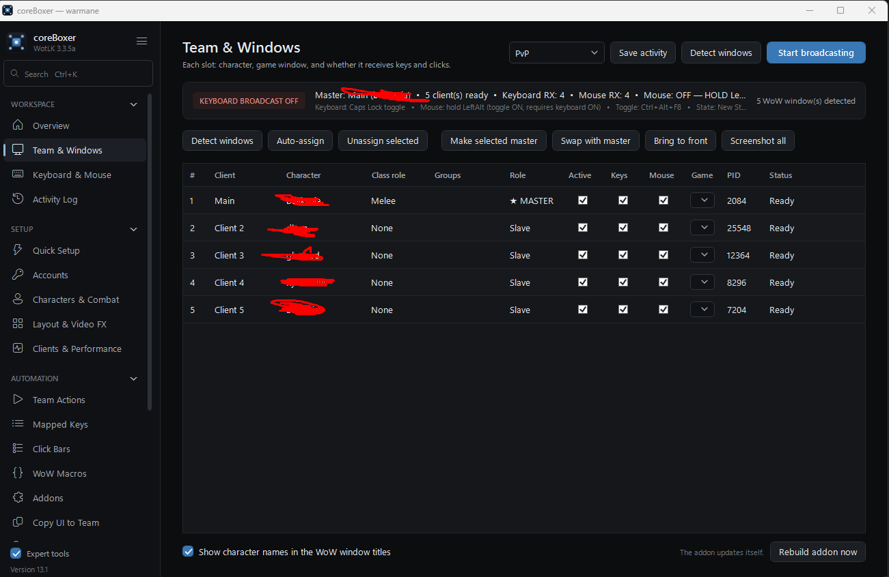

<p align="center">
  
</p>

<h1 align="center">coreBoxer</h1>

<p align="center">
  ISBoxer-style multiboxing for <b>World of Warcraft 3.3.5a</b> (Warmane and other WotLK servers) — without the complexity.
</p>

<p align="center">
  
  
  
  
</p>

<!-- Add a screenshot of the Overview page here:  -->
   <p align="center"></p>
coreBoxer plays up to ten WoW 3.3.5a clients from one keyboard and mouse. It broadcasts your keys and clicks to the
other clients **in the background**, switches the master with F1–F5, logs the whole team in for you, and writes a
small in-game addon (updated automatically) for follow, assist, run-in, mounts and more.

User-mode only: Windows window messages plus a normal WoW addon. **No injection, no drivers, no memory reading.**

> [!IMPORTANT]
> Check your server's rules on multiboxing and input broadcasting before you use it. Do not use it on Blizzard's
> official (retail / Classic) servers — input broadcasting is not allowed there.

---

## Features

**Broadcasting**
- Keyboard broadcast to background clients — Caps Lock toggles it; pauses by itself while you type in chat.
- Mouse broadcast — hold Left Alt and click: the same spot is clicked in every client, with rings showing where.
- Movement keys and Enter are never sent by default; Alt+Tab keeps working.
- A key that is *not* sent says why in the Activity Log (hotkey, addon key, blocklist, chat open, not the master).

**Team play**
- F1–F5 make a client master, with ISBoxer-style window swapping. F6–F12 stay free for your WoW bindings.
- FTL-style team actions: Follow, Assist, Assist + attack, Smart (attack if there is a target, otherwise follow),
  Come to me, Stop.
- **IWT that runs in:** press your own *Interact With Target* key (found in your WoW bindings automatically) —
  melee and tanks run to the target and attack, healers, casters and hunters stay.
- Characters & Combat: class and spec per character, one attack key for the whole team, *character keys*
  (one hotkey, every character presses its own key), ground / flying mounts with Cold Weather Flying logic.
- WoW macros written once and rendered per character (ISBoxer macro language: `{CHARACTER}`, `{MASTER}`, `!if`).
- Click bars (on-screen buttons and menus) and mapped keys (multi-step hotkeys).

**Addon features** — all off until you switch them on
Auto-invite the team · Leave BG / Wintergrasp on all · Accept summon · Mount · Hearthstone · Accept / turn in quests ·
Vendor & repair · Ready check · LFG · Resurrect from your team · Decline duels · Greed on loot.

**Clients**
- Launch + auto-login the whole team **in the background** — the master window stays in front.
- Enter World automatically; own client folders (per-client `Config.wtf`: account name, character row, FPS limits).
- Crash / disconnect guard: crashed, frozen or disconnected clients are restarted and logged back in.
- Only the master makes sound, CPU core affinity, master priority.
- Window layouts and Video FX (live views of the other clients, drawn by Windows).

**Also**
Team profiles (export / import without passwords) · Copy UI and key bindings to the team · Help & Diagnostics with
*Check my setup* and *Copy report* · Ctrl+K search · collapsible sidebar · Expert tools for key maps, routing states,
round-robin keys and mouse regions.

## Download

Get the latest `coreBoxer.exe` from **[Releases](../../releases)**. Each release lists what changed and a VirusTotal
scan link. Put the exe anywhere (Desktop, a folder of your own) — your settings are kept in `%AppData%`, so you can
replace the exe with a newer version at any time.

**Requirements:** Windows 10 or 11 (64-bit) · WoW 3.3.5a client

## Quick start

1. Download `coreBoxer.exe` from [Releases](../../releases). One file — nothing to install, no .NET needed.
   Windows may show *"Windows protected your PC"* the first time (the exe is not code-signed): click
   **More info → Run anyway**.
2. Start it **without** "Run as administrator" — WoW must not run as administrator either.
3. **Quick Setup** opens: pick `Wow.exe`, the number of clients, the character names and the default master.
4. **Setup → Accounts**: account name, password and character row per client (only for auto-login).
5. **Overview → Launch + auto-login team.** When the clients are in the world, `/reload` once if WoW asks to
   enable the addon *Vanta Master Sync* (tick *Load out of date AddOns*).
6. Press **Caps Lock** to broadcast, play, Caps Lock again to stop.

Stuck? **Advanced & Support → Help & Diagnostics → Check my setup** tells you what to fix first.

## Default keys

| Key | What it does |
|---|---|
| **Caps Lock** | keyboard broadcast on / off (or: hold a key, always on, off) |
| **Hold Left Alt + click** | repeat the click in the other clients |
| **F1–F5** | make client 1–5 the master |
| **J** | *Smart*: master has an enemy → slaves assist + attack, otherwise they follow |
| **Alt+1** | attack key (Characters & Combat) |
| your *Interact With Target* key | melee slaves run to the target |
| Ctrl+Alt+F9 / F10 / F12 | next master / broadcast on-off / **panic** |

Hotkeys only work while a WoW window is in front, so typing in a browser or Discord never affects the game.
All keys can be changed under **Automation → Team Actions**.

## How it works

- **Input**: key and mouse messages are posted to the background WoW windows. The keyboard and mouse hooks run on
  their own thread, so a busy UI never makes typing lag.
- **Addon (FTL keys)**: for every team action the addon has one macro *per possible master* (`/follow Arthas`,
  `/follow Jaina` …) on otherwise unused keys (Numpad, Insert, Home …). The app presses the key that belongs to the
  current master, so switching master never has to tell WoW anything and everything works in combat. The addon uses
  *override* bindings — your saved key bindings are never changed. It is rewritten automatically when your setup
  changes; `/reload` running clients once. `/vms` in game lists its keys.
- **IWT**: Interact With Target only runs to the target with Click-to-Move on. The addon switches Click-to-Move on
  for the run and off again when the character has arrived.

### WoW macro language

```
/assist {MASTER}
!if (character in "healers") /cast [@{MASTER}] Flash of Light
!elseif (character in "casters") /cast Frostbolt
!else /startattack
```

Variables: `{CHARACTER}` `{SLOT}` `{SLOT1}`…`{SLOT10}` `{MASTER}` / `{FTL}` `{CHARACTERSET}`.
Lines: `!if` `!elseif` `!else` `!also` `!rem`. Conditions: `character`, `master`, `is`, `in`, `not`, `and`, `or`.
Groups: roles (`tanks`, `healers`, `melee`, `ranged`, `casters`, `dps`), your own groups and the team name.

## Privacy

- Everything stays on your PC in `%AppData%\WarmaneMultiboxer` (settings, teams, log). The exe contains no user data.
- Passwords are encrypted with Windows DPAPI — readable only by your Windows user on that PC. They are never written to
  client folders, logs or exports.
- No network access, no telemetry.

## Files

| What | Where |
|---|---|
| Settings | `%AppData%\WarmaneMultiboxer\settings.json` (+ `.bak`) |
| Log | `%AppData%\WarmaneMultiboxer\logs.txt` |
| Addon | `<WoW folder>\Interface\AddOns\VantaMasterSync` |
| Screenshots | `Pictures\coreBoxer` |

## Limitations

- Made for WoW 3.3.5a. Broadcasting itself works with other old clients (1.12, 2.4.3, 4.3.4), but the addon,
  auto-login and mount logic are WotLK-specific.
- Background input is best effort — test new keys on harmless actions first.

## FAQ

**Is my data inside the exe?** No. The exe is the same for everybody; your accounts, teams and settings live only in
`%AppData%\WarmaneMultiboxer` on your own PC.

**Do I have to set up the addon?** No. coreBoxer writes it into your WoW folder and keeps it up to date. Enable
*Vanta Master Sync* once on the character screen and `/reload` after changes.

**Something doesn't work.** Open **Help & Diagnostics → Check my setup**. For a bug report, use **Copy report** there
(no passwords) and paste it into an issue.

**Updating?** Download the new exe and replace the old one. Settings stay.


## Disclaimer

coreBoxer is a fan project and is not affiliated with Blizzard Entertainment, Warmane or ISBoxer. World of Warcraft is a
trademark of Blizzard Entertainment. Use at your own risk and follow your server's rules.
